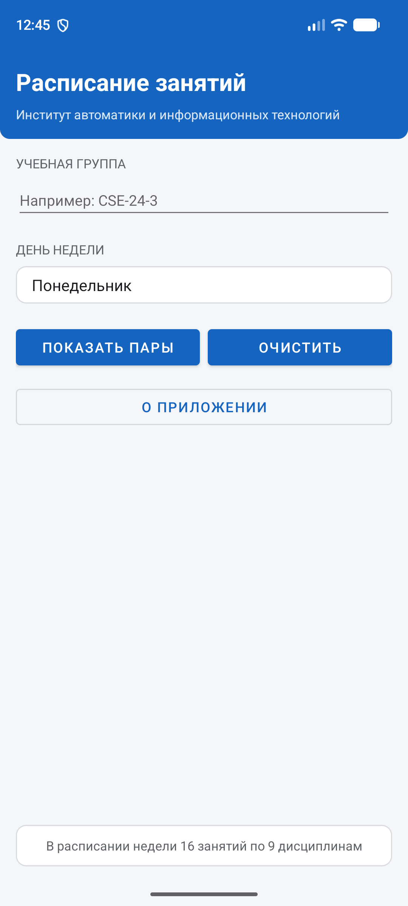
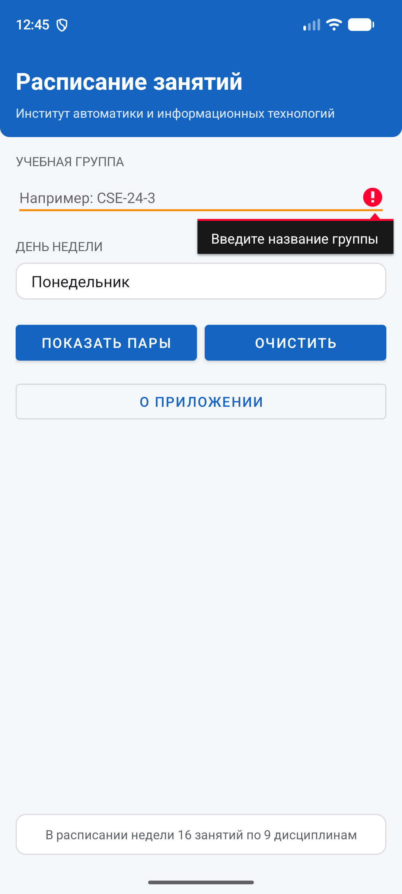
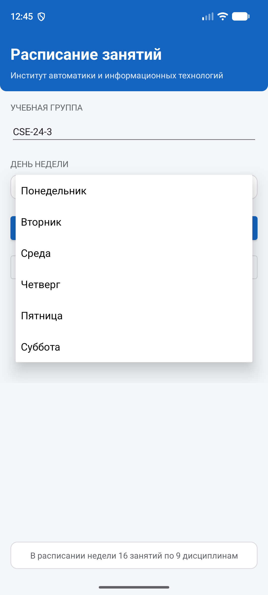
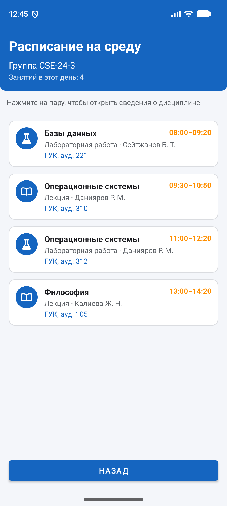
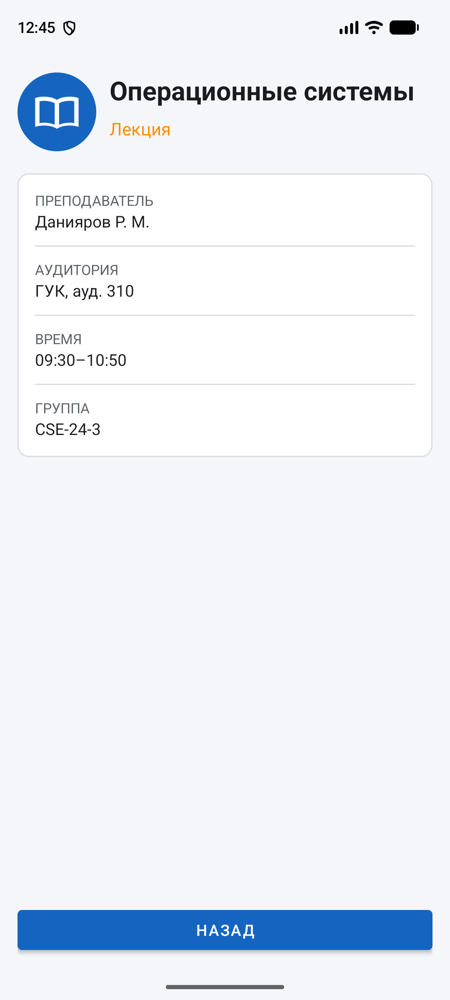
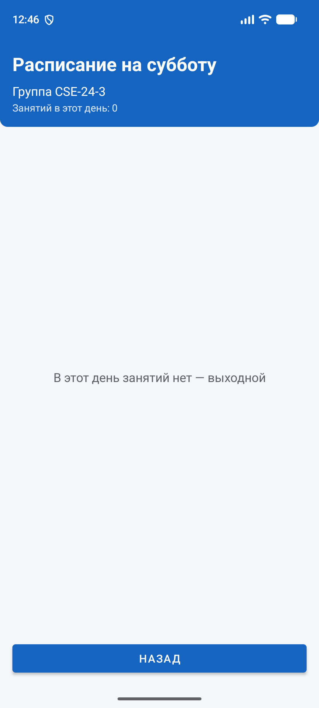
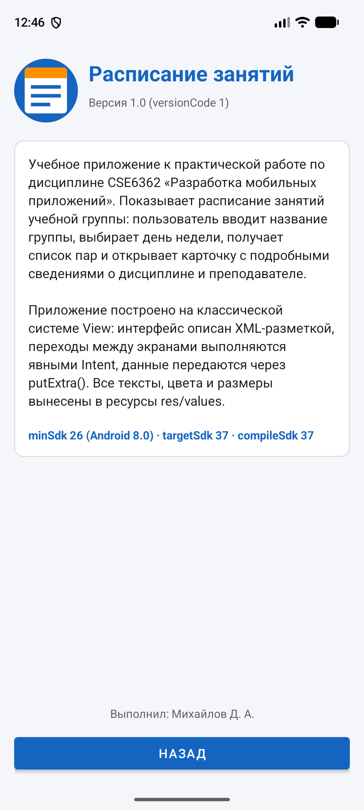

# Расписание занятий — практическая работа по CSE6362

Android-приложение на **Kotlin** с интерфейсом на **XML-разметке** (классическая система View,
без Jetpack Compose). Приложение показывает расписание учебной группы: пользователь вводит
название группы, выбирает день недели, получает список пар и открывает карточку с подробными
сведениями о дисциплине и преподавателе.

Выполнил: **Михайлов Д. А.** · Преподаватель: **Асқар Э.** · Алматы, 2026

## Версии SDK и среда

| Параметр | Значение |
| --- | --- |
| `minSdk` | 26 — Android 8.0 Oreo |
| `targetSdk` | 37 — Android 17 |
| `compileSdk` | 37 — Android 17 |
| Android Gradle Plugin | 9.4.1 |
| Gradle | 9.7.1 |
| Язык | Kotlin, JVM target 17 |
| Проверено на | эмулятор Pixel 8, Android 17 (API 37), x86_64 |

Задаются в [`app/build.gradle.kts`](app/build.gradle.kts).

## Экраны и переходы

Все четыре Activity объявлены в [`AndroidManifest.xml`](app/src/main/AndroidManifest.xml).
Стартовая — `MainActivity` (`intent-filter` с `MAIN` и `LAUNCHER`), остальные открываются
только изнутри приложения и помечены `android:exported="false"`.

| Экран | Activity | Разметка | Корневой ViewGroup |
| --- | --- | --- | --- |
| 1. Выбор группы и дня | `MainActivity` | `activity_main.xml` | **LinearLayout** |
| 2. Список пар дня | `ScheduleActivity` | `activity_schedule.xml` | **LinearLayout** |
| — карточка пары в списке | — | `item_lesson.xml` | **RelativeLayout** |
| 3. Сведения о паре | `LessonActivity` | `activity_lesson.xml` | **RelativeLayout** |
| 4. О приложении | `AboutActivity` | `activity_about.xml` | **RelativeLayout** |

Схема переходов (все Intent — явные):

```
MainActivity ──putExtra(группа, индекс дня)──> ScheduleActivity
     │                                               │
     │                                               └─putExtra(6 полей пары)─> LessonActivity
     └──(без данных)──> AboutActivity
```

## Как запустить

1. Открыть папку `Practice_Schedule` в Android Studio (File → Open).
2. Дождаться синхронизации Gradle (при первом открытии нужен интернет).
3. Нажать Run ▶ на эмуляторе или устройстве с Android 8.0 и выше.

Сборка APK из командной строки:

```bash
./gradlew assembleDebug
```

Готовый файл — `app/build/outputs/apk/debug/app-debug.apk`.

## Выполнение требований работы

| Требование | Где выполнено |
| --- | --- |
| Язык Kotlin, интерфейс на XML (без Compose) | весь `app/src/main` |
| Не менее трёх Activity, связанных явными Intent | 4 Activity, 3 перехода |
| Передача данных через `putExtra()` | `MainActivity.openSchedule()`, `ScheduleActivity.openLesson()` |
| Все Activity объявлены в манифесте, одна стартовая | `AndroidManifest.xml` |
| Использованы `LinearLayout` и `RelativeLayout` | таблица экранов выше |
| Логирование жизненного цикла и действий пользователя | все четыре Activity, теги по имени класса |
| Строки, цвета и размеры в `res/values` | `strings.xml`, `colors.xml`, `dimens.xml`, `themes.xml` |
| `minSdk = 26` (Android 8.0+) | `app/build.gradle.kts` |

## Логирование

У каждого экрана свой тег (`MainActivity`, `ScheduleActivity`, `LessonActivity`,
`AboutActivity`). В журнал пишутся:

- **Log.d** — все шесть методов жизненного цикла и служебные сообщения
  (`startActivity выполнен`, `Список построен: добавлено карточек — 4`);
- **Log.i** — действия пользователя: нажатия кнопок, выбор пары, переходы между экранами,
  приём данных из `Intent`;
- **Log.w** — ошибки ввода: пустое поле группы, выбран день без занятий;
- **Log.e** — непредвиденные данные в `Intent` (отсутствующий ключ `EXTRA_SUBJECT`,
  нераспознанный вид занятия) — срабатывает только при повреждённом Intent,
  приложение при этом не падает.

Журнал одного полного прохода по всем экранам: [`logs/logs.txt`](logs/logs.txt).
Получен командой:

```bash
adb logcat -d -v time -s MainActivity ScheduleActivity LessonActivity AboutActivity > logs/logs.txt
```

## Снимки экранов

| | |
| --- | --- |
|  |  |
| 1 — выбор группы и дня недели | 2 — пустое поле: переход отменён |
|  |  |
| 3 — список дней из `R.array.days_of_week` | 4 — пары выбранного дня |
|  |  |
| 5 — сведения, принятые через extras | 6 — день без занятий |
|  | |
| 7 — сведения о приложении и версиях SDK | |

## APK

Отладочная сборка приложения выложена в разделе
**[Releases](https://github.com/wardensu/practice_schedule-main/releases/tag/v1.0)**:
[practice_schedule_v1.0_debug.apk](https://github.com/wardensu/practice_schedule-main/releases/download/v1.0/practice_schedule_v1.0_debug.apk)
— Android 8.0 и выше.

## Структура проекта

```
Practice_Schedule/
├── app/
│   ├── build.gradle.kts                  ← версии SDK, зависимости
│   └── src/main/
│       ├── AndroidManifest.xml           ← объявление всех Activity
│       ├── java/com/example/practiceschedule/
│       │   ├── MainActivity.kt           ← экран 1: выбор группы и дня
│       │   ├── ScheduleActivity.kt       ← экран 2: список пар
│       │   ├── LessonActivity.kt         ← экран 3: карточка пары
│       │   ├── AboutActivity.kt          ← экран 4: о приложении
│       │   ├── Lesson.kt                 ← модель данных и расписание недели
│       │   └── SystemBars.kt             ← отступы системных панелей
│       └── res/
│           ├── layout/                   ← 4 экрана + карточка списка
│           ├── values/                   ← strings, colors, dimens, themes
│           ├── drawable/                 ← фоны карточек и значки занятий
│           └── mipmap-anydpi-v26/        ← адаптивный значок приложения
├── logs/logs.txt                         ← журнал работы приложения
├── screenshots/                          ← снимки экранов
├── build.gradle.kts
└── settings.gradle.kts
```

Каталоги `build/`, `.gradle/`, `.idea/` и файл `local.properties` в репозиторий не добавляются
(см. [`.gitignore`](.gitignore)).
